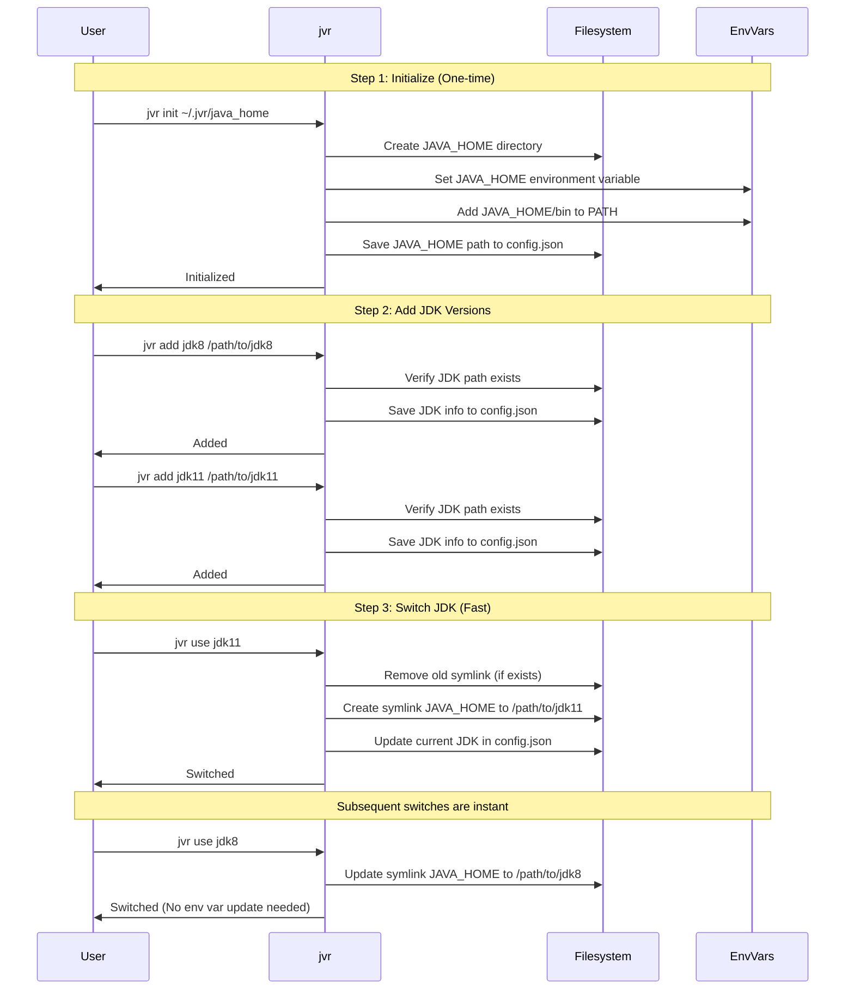
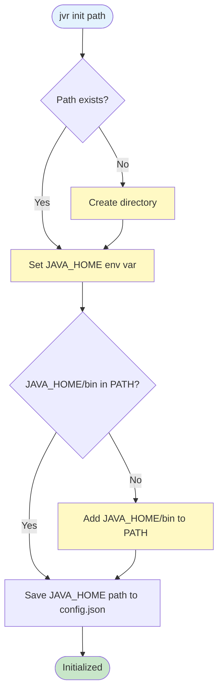
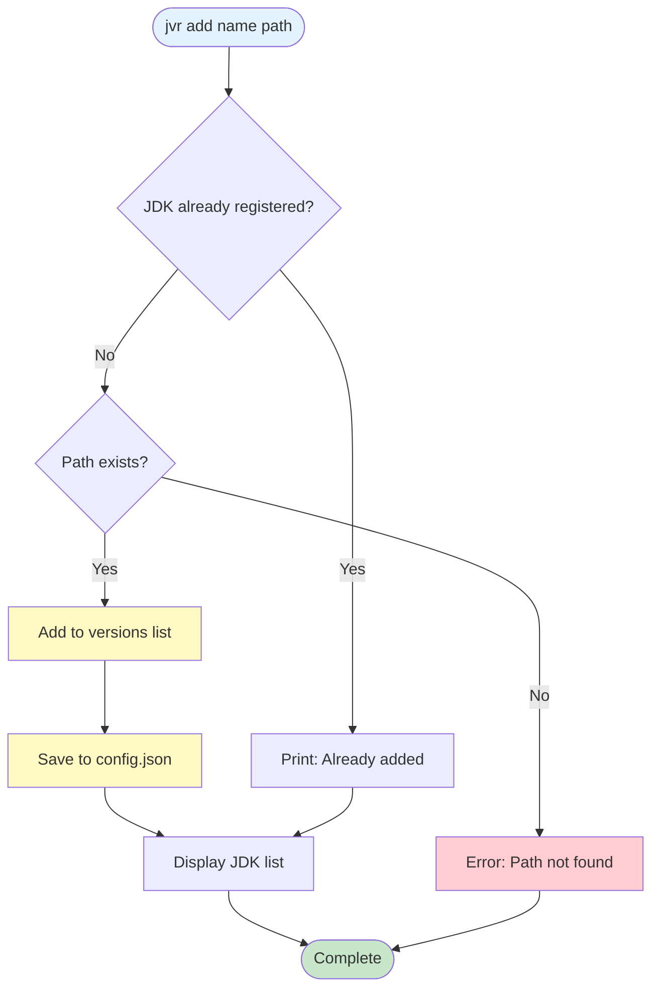
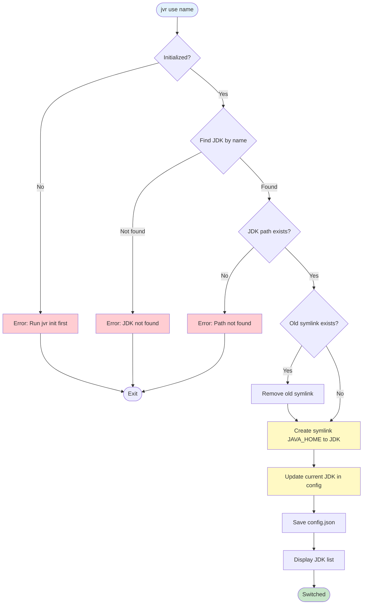
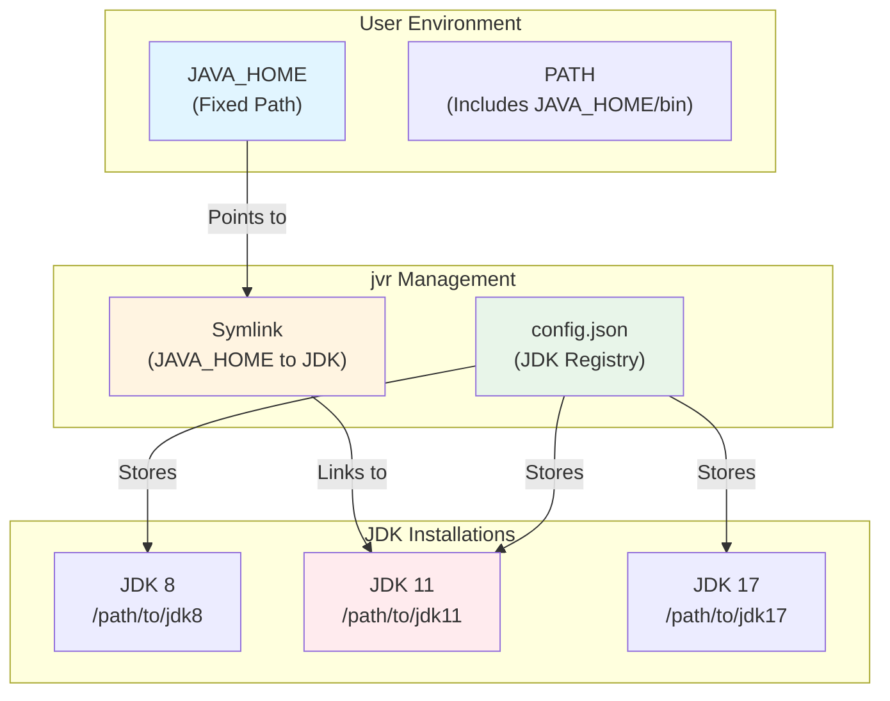

# `jvr`

A simple and easy-to-use Java version manager (registry: `jvr`), similar to `Node.js`'s `nvm`,
but it does not follow `nvm`'s naming convention. Otherwise, it would be named `jvm`,
which could cause command conflicts or ambiguity.

## ✨ What's New in v0.3.1
**Enhanced environment management & safer PATH handling:**

- 🛠 Improved environment handling: JAVA_HOME and $JAVA_HOME/bin PATH updates now fully managed in a single block
- 🧩 Safer PATH updates: Avoids issues when PATH references JAVA_HOME before it's defined
- 🔄 Reliable switching: Changing JDK versions automatically updates both JAVA_HOME and PATH in one atomic block
- 📄 Cleaner shell configs: Adds a dedicated # >>> jvr managed >>> ... <<< block, preventing conflicts with existing user configs

## 0.`Platform Support`

`jvr` supports the following operating systems:

- ✅ **Windows** (Windows 10/11)
- ✅ **Linux** (various distributions)
- ✅ **macOS** (various versions)

## 1.`Install`

### 1.1.`Download executable `

Download the executable file directly from `GitHub` and put it in any `$PATH` path.

### 1.2.`Cargo`

```shell
cargo install --git https://github.com/photowey/jvr.git [--branch main]
```

### 1.3.`Build from source`

```shell
git clone https://github.com/photowey/jvr.git
cd jvr
cargo build --release
```


## 2.`Usage`

### 2.1.`Quick Start`

**First-time setup (required):**

```shell
# Step 1: Initialize jvr with a JAVA_HOME path
$ jvr init /path/to/java_home

# Step 2: Add JDK versions
$ jvr add jdk8 /path/to/jdk8
$ jvr add jdk11 /path/to/jdk11

# Step 3: Switch between JDK versions
$ jvr use jdk11
```

**Complete Workflow Diagram:**



### 2.2.`Commands`

#### 2.2.1`Init` (v0.3.0+)

Initialize `jvr` with a JAVA_HOME path. This command must be run **once** before using other commands.

**What it does:**
- Creates the JAVA_HOME directory if it doesn't exist
- Sets the JAVA_HOME environment variable
- Adds `JAVA_HOME/bin` to your PATH environment variable

```shell
$ jvr init -h | --help
$ jvr init <JAVA_HOME_PATH>

# e.g.:
$ jvr init ~/.jvr/java_home
$ jvr init "C:\Users\YourName\.jvr\java_home"
```

**Note:** After running `jvr init`, you may need to reload your shell configuration (Unix) or restart your terminal (Windows) for the environment variables to take effect.

**Command Flow:**



#### 2.2.2`Add`

Register a JDK version with an alias name.

```shell
$ jvr add -h | --help
$ jvr add <NAME> <PATH>

# e.g.:
$ jvr add jdk8 /usr/lib/jvm/java-8-openjdk
$ jvr add jdk11 /usr/lib/jvm/java-11-openjdk
$ jvr add jdk17 "C:\Program Files\Java\jdk-17"
```

**Note:** This command only registers the JDK path. It does not modify environment variables.

**Command Flow:**



#### 2.2.3`List`

List all registered JDK versions in a formatted table. The `*` indicates the version currently in use.

```shell
$ jvr list
```

#### 2.2.4`Use`

Switch to a specific JDK version by creating a symlink from JAVA_HOME to the selected JDK path.

```shell
$ jvr use <NAME>

# e.g.:
$ jvr use jdk11
```

**How it works (v0.3.0+):**
- Creates a symlink from the JAVA_HOME path (set by `init`) to the selected JDK path
- No need to update environment variables after the first `init`
- Fast switching without modifying system configuration

**Note:** You must run `jvr init` before using this command.

**Command Flow:**



#### 2.2.5`Version`

View the version of `jvr` itself.

```shell
$ jvr version
```

#### 2.2.6`Open`

Open the directory where `jvr` configuration is located.

```shell
$ jvr open
```

## 3.`How It Works (v0.3.0)`

### 3.1.`Symlink-Based Architecture`

`jvr` v0.3.0 uses a symlink-based approach for faster JDK switching:

1. **Initialization (`jvr init`)**: Sets up a fixed JAVA_HOME path and configures environment variables once
2. **Adding JDKs (`jvr add`)**: Registers JDK paths without modifying environment variables
3. **Switching JDKs (`jvr use`)**: Creates/updates a symlink from JAVA_HOME to the selected JDK

**Benefits:**
- ⚡ **Fast switching**: No need to update environment variables on each switch
- 🔒 **Stable JAVA_HOME**: JAVA_HOME path remains constant, only the symlink target changes
- 🎯 **One-time setup**: Environment variables configured once during `init`

### 3.1.1.`Architecture Diagram`



### 3.2.`Configuration File Location`

`jvr` stores its configuration in:

- **Windows**: `%USERPROFILE%\.jvr\config.json`
- **Linux/macOS**: `~/.jvr/config.json`

The configuration file stores:
- The JAVA_HOME path (set by `init`)
- List of registered JDK versions
- Currently active JDK alias

### 3.3.`Environment Variables`

`jvr` manages the following environment variables:

- **JAVA_HOME**: Set to the path specified in `jvr init` (configured once)
- **PATH**: Automatically includes `$JAVA_HOME/bin` (Unix) or `%JAVA_HOME%\bin` (Windows)

**Important:** After running `jvr init`, you need to:
- **Unix**: Reload your shell configuration (`source ~/.bashrc` or `source ~/.zshrc`)
- **Windows**: Restart your terminal or log out and log back in

### 3.4.`Shell Configuration Files (Unix)`

On Unix systems (Linux/macOS), `jvr` automatically detects your shell and writes environment variables to the appropriate configuration file:

- **Zsh**: `~/.zshrc`, `~/.zshenv`
- **Bash**: `~/.bashrc`, `~/.bash_profile`, `~/.profile`
- **Default**: `~/.profile`

The tool will use the first available file in the list above.

## 4.`Examples`

### 4.1.`Complete Workflow`

```shell
# Step 1: Initialize jvr (one-time setup)
$ jvr init ~/.jvr/java_home
✅ Created JAVA_HOME directory: /home/user/.jvr/java_home
✅ jvr initialized successfully!
   JAVA_HOME: /home/user/.jvr/java_home
   Use 'jvr use <alias>' to switch between JDK versions.

# Reload shell configuration (Unix only)
$ source ~/.bashrc  # or ~/.zshrc

# Step 2: Add JDK versions
$ jvr add jdk8 /usr/lib/jvm/java-8-openjdk
✅ Added JDK version: ['jdk8']

$ jvr add jdk11 /usr/lib/jvm/java-11-openjdk
✅ Added JDK version: ['jdk11']

$ jvr add jdk17 /usr/lib/jvm/java-17-openjdk
✅ Added JDK version: ['jdk17']

# Step 3: List all registered JDKs
$ jvr list
+-----+-------+----------------------------------+---------+
| #   | Alias | Path                             | Current |
+=====+=======+==================================+=========+
| 1   | jdk8  | /usr/lib/jvm/java-8-openjdk      | -       |
| 2   | jdk11 | /usr/lib/jvm/java-11-openjdk     | -       |
| 3   | jdk17 | /usr/lib/jvm/java-17-openjdk     | -       |
+-----+-------+----------------------------------+---------+

# Step 4: Switch to a specific JDK version
$ jvr use jdk17
✅ Now using JDK jdk17 at /usr/lib/jvm/java-17-openjdk
   JAVA_HOME symlink: /home/user/.jvr/java_home -> /usr/lib/jvm/java-17-openjdk

# Verify the change
$ echo $JAVA_HOME
/home/user/.jvr/java_home

$ java -version
openjdk version "17.0.x" ...

# Switch to another JDK (fast, no environment variable update needed)
$ jvr use jdk11
✅ Now using JDK jdk11 at /usr/lib/jvm/java-11-openjdk
   JAVA_HOME symlink: /home/user/.jvr/java_home -> /usr/lib/jvm/java-11-openjdk
```

### 4.2.`Platform-Specific Examples`

**Windows:**
```shell
# Initialize
$ jvr init "C:\Users\YourName\.jvr\java_home"
✅ Created JAVA_HOME directory: C:\Users\YourName\.jvr\java_home
✅ jvr initialized successfully!

# Add and use JDKs
$ jvr add jdk21 "C:\Program Files\Java\jdk-21"
$ jvr use jdk21
✅ Now using JDK jdk21 at C:\Program Files\Java\jdk-21
   JAVA_HOME symlink: C:\Users\YourName\.jvr\java_home -> C:\Program Files\Java\jdk-21
```

**Linux/macOS:**
```shell
# Initialize
$ jvr init ~/.jvr/java_home
✅ Created JAVA_HOME directory: /home/user/.jvr/java_home
✅ jvr initialized successfully!

# Reload shell
$ source ~/.bashrc  # or ~/.zshrc

# Add and use JDKs
$ jvr add jdk21 /usr/lib/jvm/java-21-openjdk
$ jvr use jdk21
✅ Now using JDK jdk21 at /usr/lib/jvm/java-21-openjdk
   JAVA_HOME symlink: /home/user/.jvr/java_home -> /usr/lib/jvm/java-21-openjdk
```

## 5.`Troubleshooting`

### 5.1.`"jvr has not been initialized" Error`

If you see this error when running `jvr use`:

```
❌ jvr has not been initialized. Please run 'jvr init <JAVA_HOME_PATH>' first.
```

**Solution:** Run `jvr init` with a JAVA_HOME path before using other commands:

```shell
$ jvr init ~/.jvr/java_home
```

### 5.2.`Environment Variable Not Updated After Init (Unix)`

If `JAVA_HOME` is not set after running `jvr init`:

1. Check if the environment variable was written to your shell config file:
   ```shell
   $ cat ~/.bashrc | grep JAVA_HOME
   # or
   $ cat ~/.zshrc | grep JAVA_HOME
   ```

2. Reload your shell configuration:
   ```shell
   $ source ~/.bashrc  # or ~/.zshrc
   ```

3. Verify in a new terminal window:
   ```shell
   $ echo $JAVA_HOME
   ```

### 5.3.`Symlink Creation Failed`

If you encounter errors when switching JDK versions:

**Windows:**
- Ensure you have administrator privileges or developer mode enabled for creating symlinks
- Check if the JAVA_HOME directory exists and is writable

**Unix:**
- Ensure you have write permissions to the JAVA_HOME directory
- Check if the target JDK path exists and is accessible

### 5.4.`Permission Denied (Unix)`

If you encounter permission errors:

```shell
# Check permissions
$ ls -la ~/.jvr/

# Fix permissions if needed
$ chmod 755 ~/.jvr/java_home
```

**Note:** It's recommended to use user-level directories (like `~/.jvr/java_home`) to avoid permission issues.

### 5.5.`JDK Path Does Not Exist`

If you see this error when adding or using a JDK:

```
❌ JDK path does not exist: /path/to/jdk
```

**Solution:** Verify the JDK path is correct and the directory exists:

```shell
$ ls -la /path/to/jdk
# or on Windows
$ dir "C:\path\to\jdk"
```

## 6.`License`

Licensed under the Apache License, Version 2.0. See [LICENSE](LICENSE) for details.